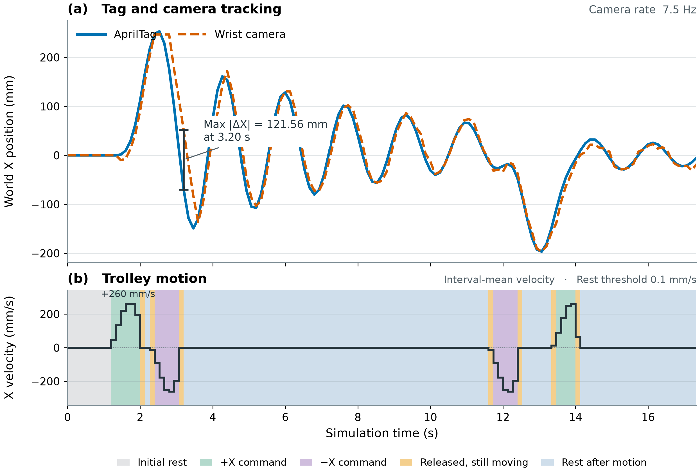
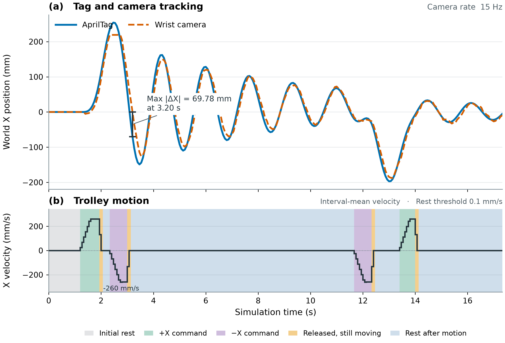
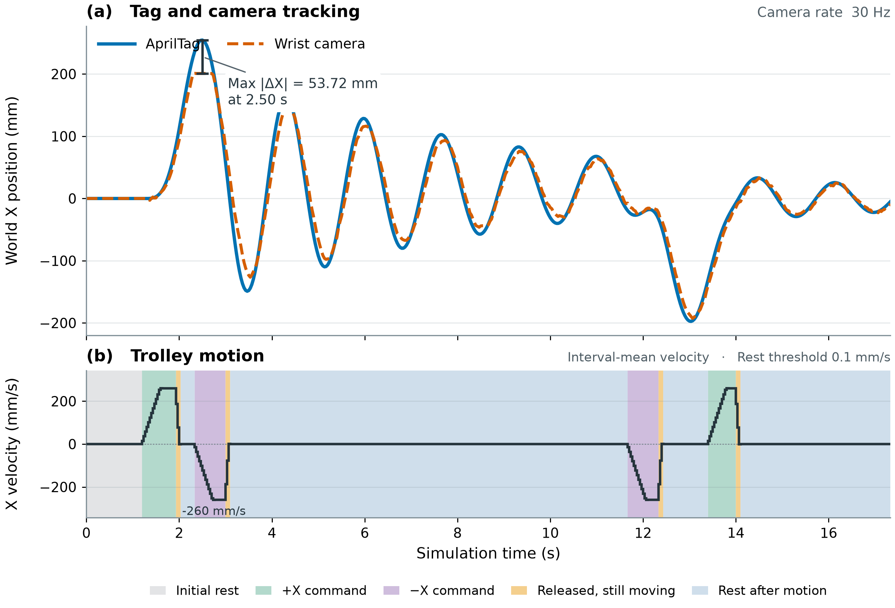
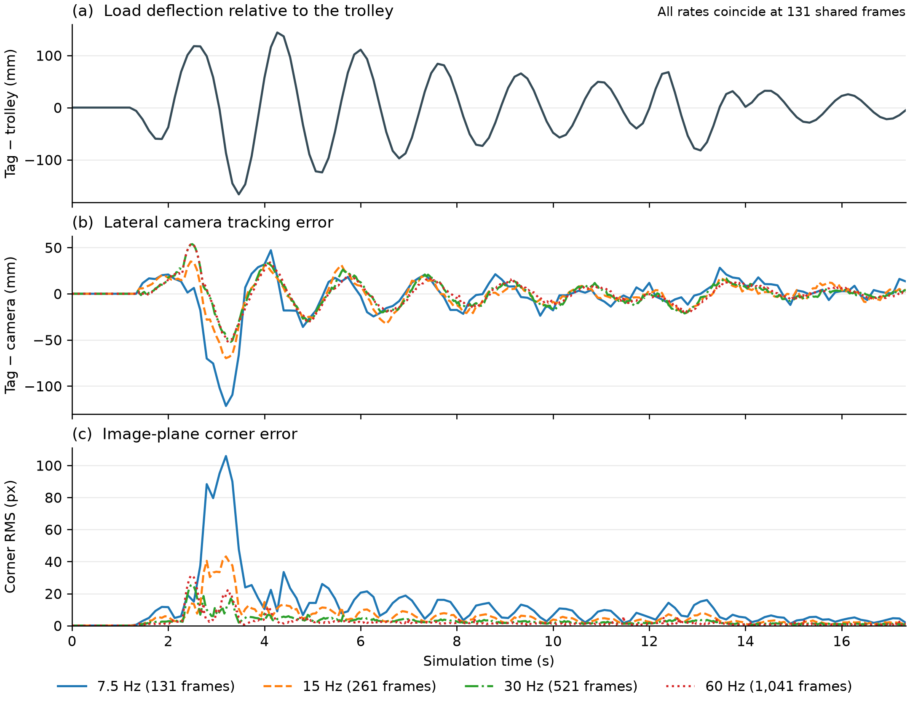

# Visual feedback rate and lateral tracking of a suspended AprilTag

## Objective

Examined how the visual feedback rate affected a wrist camera's ability to track a swinging load during trolley reversals and braking. Tracking was assessed in world coordinates and in the image plane. The ultimate goal is to test the most suitable visual feedback rate that can track the movement of robot arm while maintaining the rate at a relatively lower rate.

## Methods

### Experimental design

In PyBullet, a Franka Panda tracked an AprilTag on a freely swinging load. The trolley moved along the world X axis while the gantry Y and hoist commands remained zero. Each of four 17.33 s runs used the same timed trolley commands, initial pose, and controller gains. Image acquisition and visual control updated together at 7.5, 15, 30, or 60 Hz. Trolley commands took effect on the 240 Hz physics clock. [Simulation model](visual_servo_tracking.py) · [15 Hz input and position record](results/tracking_15Hz.csv)

### Visual servo control

The wrist camera tracked the four corners of a 0.06 m AprilTag in 640 × 480 images. Its focal length was 376.72 px and its principal point was (320, 239) px. The controller moved the arm to keep the tag centered, facing the camera at 0.28 m. It used the change in estimated tag position between frames to follow the moving load. Joint speeds were limited to 1.2 rad/s, and corrections stopped when the corner error fell to 0.15 px or less.

<!--
The desired view was a centered, front-facing tag at 0.28 m. The wrist camera had a resolution of 640 × 480 px, a focal length $f=376.72$ px, and a principal point at $(320,239)$ px. For each corner of the 0.06 m square tag, $(u_i,v_i)$ denotes its detected pixel coordinates and $(X_i,Y_i)$ its coordinates in the tag plane. With image $y$ increasing downward, the measured and desired normalized coordinates are

$$
s_i=\frac{1}{f}\begin{bmatrix}u_i-320\\v_i-239\end{bmatrix},
\qquad
s_i^*=\frac{1}{0.28}\begin{bmatrix}X_i\\-Y_i\end{bmatrix}.
$$

Stacking the four residuals $s_i-s_i^*$ gives $e\in\mathbb{R}^8$. The per-frame corner error $E_{\rm px}=f\lVert e\rVert_2/\sqrt{8}$ is the root mean square (RMS) over the eight pixel-coordinate residuals.

A perspective-n-point (PnP) estimate of tag pose gives the corner depths $Z_i$. For $s_i=(x_i,y_i)^\top$, each corner contributes the interaction matrix

$$
L_i=
\begin{bmatrix}
-1/Z_i & 0 & x_i/Z_i & x_i y_i & -(1+x_i^2) & y_i\\
0 & -1/Z_i & y_i/Z_i & 1+y_i^2 & -x_i y_i & -x_i
\end{bmatrix}.
$$

Stacking the four matrices gives $L$. With the camera's optical-center Jacobian $J_c$ expressed in camera coordinates, the image Jacobian is $A=LJ_c$. The damped least-squares control law is

$$
\begin{aligned}
A^\# &= A^\top(AA^\top+0.012^2 I_8)^{-1},\\
\dot q &= A^\#(-9e+L_v v_{\rm tag}^{c})+
(I_7-A^\# A)\,0.08(q_{\rm home}-q).
\end{aligned}
$$

The translation block $L_v$ comprises the first three columns of $L$. The feedforward term uses the tag velocity $v_{\rm tag}^{c}$, obtained by differencing consecutive PnP-based world-position estimates over one camera period and rotating the velocity into camera coordinates. The final term biases the joints toward their home posture. Joint speeds were limited to 1.2 rad/s, and corrections were held when $E_{\rm px}\leq0.15$ px.
-->

### Outcome measures

Load deflection was the lateral position of the tag relative to the trolley. Camera tracking offset was the lateral position of the tag relative to the camera. Both were measured in millimeters along the world X axis. The root mean square and peak absolute tracking offsets were calculated over all frames in each run. Image error was the root mean square of the horizontal and vertical pixel errors at all four corners. Its mean was compared at the 131 capture times shared by all four runs.

<!--
From simulated world positions in meters, $e_T=1000(X_{\rm tag}-X_{\rm trolley})$ measures load deflection and $e_C=1000(X_{\rm tag}-X_{\rm camera})$ measures camera tracking offset, both in millimeters. Lateral tracking RMSE, $\sqrt{\sum_{k=1}^N e_{C,k}^2/N}$, and peak absolute offset were calculated over each run's $N$ camera frames. For each rate, mean corner error was calculated over the same 131 capture times.
-->

## Results

### Tracking trajectories and the 15 Hz baseline

| 7.5 Hz | 15 Hz |
| --- | --- |
|  |  |

| 30 Hz | 60 Hz |
| --- | --- |
|  |  |

**Figure 1.** World X positions of the tag and camera (upper panels) and interval-mean trolley velocity (lower panels). Velocity was estimated from the change in trolley position between consecutive frames. 

<!--
Velocity was calculated as $v_k=1000(X_{{\rm trolley},k+1}-X_{{\rm trolley},k})/(t_{k+1}-t_k)$ in mm/s.
-->

The 15 Hz run illustrates the response to braking in Figure 1. All 261 frames yielded corner measurements. After the negative-X command ended at 3.00 s, the trolley settled near +17.33 mm. Between 3.13 and 3.20 s the tag swung from −29.90 to −69.68 mm. The camera was still at +0.11 mm at 3.20 s, when both tracking errors peaked (Table 1).

**Table 1.** Image-plane and lateral tracking errors at 15 Hz. The mean uses all 261 frames.

| Metric | Mean over frames | Peak (3.20 s) | Final (17.33 s) |
| --- | ---: | ---: | ---: |
| Corner RMS error (px) | 5.61 | 43.19 | 1.23 |
| Absolute tag–camera X offset (mm) | 10.84 | 69.78 | 4.58 |

### Frame-rate comparison

**Figure 2.** (a) Signed tag–trolley offset at shared capture times. (b) Signed tag–camera offset and (c) corner RMS error at each camera's native frame times.

The four runs had identical load deflection at the 131 shared capture times, reaching −166.38 mm at 3.47 s (Figure 2a). Camera tracking differed during the same motion. At 7.5 Hz, the signed offset reached −121.56 mm at 3.20 s. At 30 and 60 Hz, the peak absolute offset was about 54 mm (Figure 2b). The mean corner error at shared times fell from 12.35 px at 7.5 Hz to 2.34 px at 60 Hz (Table 2). Even so, the corner-error peak at 2.50 s was higher at 60 Hz than at 30 Hz (31.27 and 25.62 px, respectively, Figure 2c).

**Table 2.** Errors by feedback rate. Lateral RMSE and peak offset use all frames in each run. Mean corner error uses the 131 shared capture times.

| Camera rate | Frames | Lateral tracking RMSE (mm) | Peak absolute offset (mm) | Mean per-frame corner RMS (px) | Recording |
| ---: | ---: | ---: | ---: | ---: | --- |
| 7.5 Hz | 131 | 23.84 | 121.56 | 12.35 | [CSV](results/tracking_7.5Hz.csv) |
| 15 Hz | 261 | 16.08 | 69.78 | 5.65 | [CSV](results/tracking_15Hz.csv) |
| 30 Hz | 521 | 14.78 | 53.72 | 2.81 | [CSV](results/tracking_30Hz.csv) |
| 60 Hz | 1,041 | 14.33 | 53.77 | 2.34 | [CSV](results/tracking_60Hz.csv) |

## Discussion

For this trolley trajectory, the largest reduction in lateral tracking RMSE occurred when the feedback rate doubled from 7.5 to 15 Hz (7.76 mm). Doubling the rate from 30 to 60 Hz yielded a further reduction of 0.45 mm. These results describe the combined effect of faster image acquisition and more frequent control updates in one run per rate.
