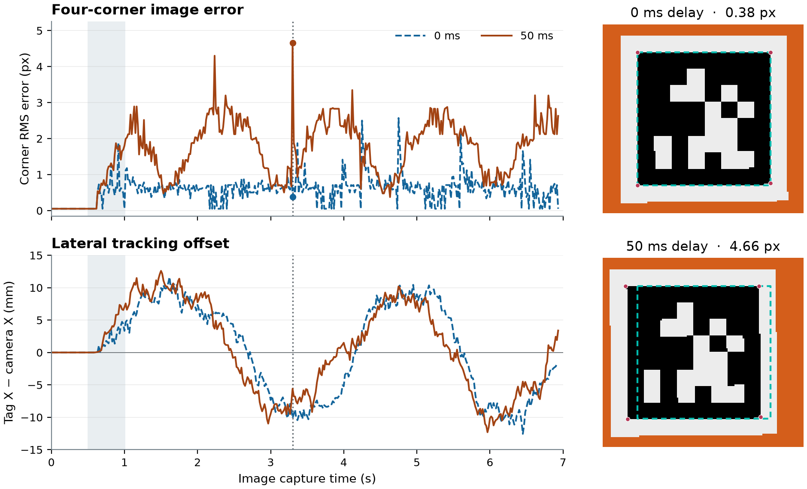

# Effect of a 50 ms image-transfer delay on suspended-load tracking

## Objective

Measure how a 50 ms delay between image capture and delivery changes a Franka Panda's ability to keep a swinging AprilTag aligned in its wrist camera. The camera ran at 60 Hz in both trials.

## Methods

Two 7.00 s PyBullet runs used the same initial pose, controller gains and trolley commands. The trolley carried a 1 kg cube (30 × 30 × 30 cm) on a 2.00 m cable. At 0.50 s, a scripted input drove the trolley along world +X. At 1.00 s, the input was released to brake. The speed limit was 0.20 m/s, and acceleration and braking were both 2.0 m/s². The gantry Y axis and hoist remained stationary. [Simulation model](visual_servo_tracking_v2.py)

Only the image-transfer delay changed. The wrist camera captured a 640 × 480 image every four steps of the 240 Hz physics simulation. In the 0 ms run, the controller processed each frame at capture. In the 50 ms run, it processed the frame 12 physics steps later, equivalent to three camera periods. Both controllers aimed to centre the 60 mm tag in a front-facing view at 0.28 m.

Each run captured 420 frames. By the end, 420 had arrived in the 0 ms run and 417 in the 50 ms run. All delivered frames yielded a tag measurement. The table and curves use the **417 shared capture times** from 0 to 6.93 s. The recorded delivery timestamps confirm the specified delay for every frame. [0 ms frame data](results_v2/trolley_stop_60Hz_0ms.csv) · [50 ms frame data](results_v2/trolley_stop_60Hz.csv)

## Results

The trolley and tag followed identical X trajectories at every shared capture time. The trolley stopped at X = 100.00 mm by 1.10 s. The tag continued to swing and reached X = 192.51 mm at 2.28 s. [Trolley, tag and camera trajectories in the 50 ms run](results_v2/trolley_stop_60Hz.png)

| Tracking metric | 0 ms delay | 50 ms delay | Change with delay |
| --- | ---: | ---: | ---: |
| Mean per-frame corner RMS error | 0.58 px | 1.63 px | +1.05 px (+182%) |
| Peak per-frame corner RMS error | 2.57 px | 4.66 px | +2.09 px (+81%) |
| RMS tag–camera X offset | 6.78 mm | 6.58 mm | −0.20 mm (−3%) |
| Peak absolute tag–camera X offset | 12.56 mm | 12.59 mm | +0.04 mm (+0.3%) |

Corner error is the per-frame RMS of the eight horizontal and vertical pixel errors at the four tag corners. Lateral offset is the tag's world X position minus the camera's world X position at capture. Changes were calculated before rounding.

**Figure 1.** Shading marks the +X command. The dotted line marks 3.30 s, when the delayed run reached its largest image error. The right panels show the same crop from each wrist camera at that capture time. The dashed rectangle marks the desired tag outline, and the dots mark the detected corners.

At 3.30 s, the tag centre was **6.55 px left of the desired centre** with delay and horizontally centred to within **0.01 px** without delay. The corresponding four-corner errors were **4.66 px** and **0.38 px**. At 1.10 s, just as the trolley stopped, the camera trailed the tag along world X by 9.71 mm with delay and 5.36 mm without it.

## Conclusion

For this trolley move and controller, the 50 ms transfer delay increased the **mean image alignment error by a factor of 2.82**. The camera still followed the load laterally through the swing. Across the run, its RMS X offset changed by only 0.20 mm, and the peak stayed near 12.6 mm in both cases. The tag–camera X distance measures one world axis, while the projected corners also depend on camera orientation and depth. This explains why the two X trajectories alone give little indication of the loss in image alignment.
